# OneAI Assist — Email Marketing Suite (E1–E10)
## Complete QA Testing & Feature Verification Guide

**Document Version:** 1.0.0  
**Target Audience:** QA Engineering Team, Product Managers, Platform Testers  
**System Under Test:** OneAI Assist Email Marketing Platform  
**Environment:** `http://localhost:3000` (Local / Staging)  
**Credentials for Testing:** `admin@agency.com` / `password123`

---

## 1. System Architecture & Prerequisites

Before starting QA execution, ensure the two core services are running:

1. **Web Application (Next.js)**:
   - Command: `npm run dev`
   - URL: `http://localhost:3000`
2. **Background Worker Daemon**:
   - Command: `npm run worker`
   - Log verification: `[Worker] Email campaign worker starting (poll=5000ms)`
3. **Database**:
   - PostgreSQL (Supabase / local) connected via `DATABASE_URL`.

> [!IMPORTANT]
> **Asynchronous Sending Architecture**: In OneAI Assist, **no marketing emails are ever sent inside HTTP request handlers**. When a user launches a campaign, the API creates a `QUEUED` campaign and returns HTTP `202 Accepted` immediately. The background worker daemon claims jobs in batches, validates domain verification and suppression, and sends emails with concurrency control.

---

## 2. Feature-by-Feature Testing Guide (E1 to E10)

```mermaid
flowchart LR
    E1["E1: Queue & Worker"] --> E2["E2: Contacts & Lists"]
    E2 --> E3["E3: Dynamic Segments"]
    E3 --> E4["E4: Domain Verification"]
    E4 --> E5["E5: Safe Templates"]
    E5 --> E6["E6: Campaign Builder"]
    E6 --> E7["E7: Tracking & Compliance"]
    E7 --> E8["E8: Analytics & Reports"]
    E8 --> E9["E9: A/B Testing"]
    E9 --> E10["E10: Journeys & Automations"]
```



---

### Step E1: Broadcast Queue, Worker Daemon & Multi-Tenant Throttling

#### A. What Was Implemented
- Database models: `BroadcastCampaign` (`channel: EMAIL`, `status: QUEUED | SENDING | COMPLETED | FAILED | PAUSED`), `BroadcastJob` (`status: PENDING | PROCESSING | SENT | FAILED | SKIPPED_INVALID | SKIPPED_SUPPRESSED`).
- Worker daemon (`worker/index.ts` and `worker/campaignRunner.ts`):
  - Recovers stale locks (`lockedAt < now - 10m`).
  - Starts due `QUEUED` campaigns.
  - Builds audiences in batches of 1,000 without loading whole customer tables into memory.
  - Round-robin tenant rotation to prevent one agency from monopolizing provider rate limits.
  - Exponential retry backoff on transient network failures (`RETRY_BACKOFF_MS = [1m, 5m, 30m, 2h]`).
  - Daily quota enforcement (`dailyQuota` on `TenantEmailConfig`).

#### B. How QA Can Test It
1. **Automated Verification**:
   ```bash
   npx tsx --test test/worker/e1.test.ts
   ```
   *Expected:* 10/10 tests pass (verifies lock recovery, queue dispatch, quota limits, tenant rotation).
2. **Manual UI Verification**:
   - Go to `http://localhost:3000/dashboard/marketing/email`.
   - Click the **Campaign Builder** tab.
   - Enter campaign name `E1 Test`, select an audience, template, and choose **Send Immediately**.
   - Open Browser DevTools Network tab and click **Launch Campaign**.
   - *Expected:* `POST /api/dashboard/broadcast` returns **HTTP 202 Accepted** with `{ status: "QUEUED", sent: 0 }`.
   - Check the **Campaigns & Analytics** table: status transitions from `QUEUED` → `SENDING` (with an amber animated pulse and progress bar) → `COMPLETED`.

---

### Step E2: Contacts, Lists, CSV Import & Consent Proof

#### A. What Was Implemented
- Database models: `ContactList`, `ContactListMember`, `ContactImportJob`, and extended `Customer` fields.
- Background CSV import engine (`lib/contacts/csvImport.ts`):
  - Streams and processes large CSV files up to 10,000 rows in chunks of 500.
  - De-duplicates by lowercase email address (updates existing records instead of duplicating).
  - Explicit consent tracking: `emailConsentStatus` (`SUBSCRIBED | UNSUBSCRIBED | PENDING`), `emailConsentSource`, `emailConsentTimestamp`, `emailConsentProof`.
  - Fixes security issue where sensitive fields (e.g. `otpCode`, `hashedPassword`) were stripped via `CONTACT_PUBLIC_SELECT`.

#### B. How QA Can Test It
1. **Automated Verification**:
   ```bash
   npx tsx --test test/worker/e2.test.ts
   ```
   *Expected:* 10/10 tests pass.
2. **Manual UI Verification**:
   - Navigate to `http://localhost:3000/dashboard/customers`.
   - **Test 1 (Single Contact Creation)**:
     - Click **Add Contact**. Enter Name `Alice QA`, Email `alice.qa@example.com`, Phone `+15551234567`, Tags `VIP`, Consent Source `Web Form`.
     - Save contact. Verify `emailConsentStatus` is `SUBSCRIBED` and `otpCode` is NOT present anywhere in the DOM or API response.
   - **Test 2 (CSV Import & De-duplication)**:
     - Upload a test CSV containing:
       ```csv
       name,email,tags,company
       Bob Tester,bob.qa@example.com,BETA,Acme
       Alice QA,alice.qa@example.com,VIP,UpdatedAcme
       ```
     - Provide Consent Source: `Website Lead Form`.
     - *Expected:* API returns `202 Accepted` with an import `jobId`.
     - Poll `/api/contacts/import-csv/<jobId>`: status becomes `COMPLETED` with `importedCount = 2`.
     - Re-import the exact same CSV. Verify total customer count does NOT increase (0 duplicates created).

---

### Step E3: Dynamic Segments & Live Rule Trees

#### A. What Was Implemented
- Model `Segment` with JSON rule tree (`condition: "AND" | "OR"`, `rules: [...]`).
- Supported filter rules:
  - `tag` (`equals`, `not_equals`)
  - `custom_field` (key-value evaluation)
  - `consent` (`status` equals `SUBSCRIBED`)
  - `email_engagement` (`OPENED_LAST_30_DAYS`, `CLICKED_ANY`, `NEVER_BOUNCED`)
- Live audience count endpoint: `GET /api/segments/[id]/count?channel=EMAIL` and `POST /api/segments/preview-count`.
- Automatic suppression filtering: Bounced and unsubscribed contacts are automatically excluded from the count.

#### B. How QA Can Test It
1. **Automated Verification**:
   ```bash
   npx tsx --test test/worker/e3.test.ts
   ```
   *Expected:* 10/10 tests pass.
2. **Manual UI Verification**:
   - Go to `http://localhost:3000/dashboard/marketing/email` -> **Campaign Builder**.
   - Advance to **Step 2 (Audience)**.
   - Click **Saved Segment**.
   - Choose a saved segment from the dropdown.
   - *Expected:* The **Estimated Recipients** pill instantly calls `/api/segments/[id]/count?channel=EMAIL` and displays the exact audience count (e.g. `24 Recipients`) and note: *"Bounced and unsubscribed contacts automatically excluded"*.

---

### Step E4: Sender and Sending Domain Verification (DKIM/SPF)

#### A. What Was Implemented
- Models: `TenantSendingDomain` (`status: PENDING | VERIFIED | FAILED`), `TenantEmailConfig`.
- Strict pre-send domain check in worker (`worker/campaignRunner.ts` Phase 1):
  - Inspects `fromEmail` domain against `TenantSendingDomain`.
  - If unverified, the campaign is marked `FAILED` immediately without sending any emails.
  - Error message displayed to user:  
    > *"From address domain 'domain.com' is not a verified sending domain for this organization. Please add and verify this sending domain under Settings > Email Domains."*
  - Eliminates mock key fallbacks (`mock_email_key`).

#### B. How QA Can Test It
1. **Automated Verification**:
   ```bash
   npx tsx --test test/worker/e4.test.ts
   ```
   *Expected:* 10/10 tests pass.
2. **Manual UI Verification**:
   - Go to `http://localhost:3000/dashboard/settings` -> **Email Domains**.
   - Add an unverified domain `unverified-qa-test.com` (status `PENDING`).
   - Create a campaign using `announcements@unverified-qa-test.com`.
   - Launch the campaign.
   - *Expected:* In **Campaigns & Analytics**, the campaign status updates to a red **FAILED** badge. Clicking the campaign shows the clear instruction to verify DNS records under Settings.

---

### Step E5: Templates, Merge Fields, Compliance Footer & Sanitization

#### A. What Was Implemented
- Template merge tags: `{{name}}`, `{{first_name}}`, `{{email}}`, `{{active_policy}}` with fallback syntax (e.g. `{{first_name | 'Valued Customer'}}`).
- Enforced compliance footer:
  - Automatically injects tenant physical postal address (`{{sender_address}}`).
  - Automatically injects working one-click unsubscribe link (`{{unsubscribe_url}}`).
- Security sanitization:
  - Strips `<script>`, `onerror=`, `javascript:`, and dangerous attributes on save (`SEC-21`).
  - Preview iframes strictly sandboxed with `sandbox="allow-same-origin"` (no `allow-scripts`).

#### B. How QA Can Test It
1. **Automated Verification**:
   ```bash
   npx tsx --test test/worker/e5.test.ts
   ```
   *Expected:* 10/10 tests pass.
2. **Manual UI Verification**:
   - Go to `http://localhost:3000/dashboard/marketing/email` -> **Email Templates**.
   - Click **New Template**.
   - Enter HTML containing `<script>alert('xss')</script><p>Hello {{first_name}}</p>`.
   - Save and inspect: Verify the `<script>` tag is stripped.
   - Inspect the template preview iframe in DevTools: Verify the DOM element has `sandbox="allow-same-origin"` and lacks `allow-scripts`.
   - Send a test email to your inbox: Verify the bottom of the email contains the physical postal address and Unsubscribe link.

---

### Step E6: 5-Step Campaign Flow, Checklist & Live Progress

#### A. What Was Implemented
- Structured 5-step stepper in Campaign Builder:
  1. **Details**: Name, Subject, Preheader, A/B toggle.
  2. **Audience**: Saved Segments, CRM Tags, Pipeline Stage, Engagement filter.
  3. **Content**: Visual template picker, AI subject generator, live Desktop/Mobile preview, Test Send modal.
  4. **Review**: Pre-Flight Deliverability Checklist with live status indicators.
  5. **Schedule**: Campaign Summary review, Send Immediately vs Schedule for Later.
- Live progress bar on `Campaigns & Analytics` table (`liveJobs.sent / liveJobs.total`).
- Campaign deletion route: `DELETE /api/dashboard/broadcast/[id]`.

#### B. How QA Can Test It
1. **Automated Verification**:
   ```bash
   npx tsx --test test/worker/e6.test.ts
   ```
   *Expected:* 10/10 tests pass.
2. **Manual UI Verification**:
   - Go to **Campaign Builder**. Walk through all 5 steps.
   - In **Step 4 (Review)**, verify all checklist cards render:
     - Email Provider Configured
     - Verified Sending Domain
     - Subject Line Set
     - Content Template Selected
     - Audience Available & Within Quota
     - Compliance Footer & Unsubscribe Included
   - In **Step 5 (Schedule)**, launch the campaign.
   - In **Campaigns & Analytics**, locate the campaign and click the **Trash** icon. Confirm deletion.

---

### Step E7: Tracking Pixels, HMAC Redirects, Unsubscribe & Auto-Pause

#### A. What Was Implemented
- Cryptographic tokens signed using dedicated secret (`EMAIL_TRACKING_SECRET`):
  - **Open Tracking**: `GET /api/channels/email/track/open?token=...` returns a 1x1 transparent GIF with `Cache-Control: no-store`.
  - **Click Tracking**: `GET /api/channels/email/track/click?token=...` records click and performs safe HTTP 302 redirect (open redirect protected).
  - **Unsubscribe (Crawler Protected)**:
    - `GET /api/channels/email/unsubscribe?token=...` displays clean confirmation page (prevents antivirus email crawlers from unsubscribing users).
    - `POST /api/channels/email/unsubscribe` executes unsubscribe, updates `emailConsentStatus = 'UNSUBSCRIBED'`, and adds contact to `GlobalSuppression`.
- Rolling Auto-Pause:
  - If bounce rate exceeds 5% or complaint rate exceeds 0.1% over last 50 emails, campaigns pause automatically to protect domain reputation.

#### B. How QA Can Test It
1. **Automated Verification**:
   ```bash
   npx tsx --test test/worker/e7.test.ts
   ```
   *Expected:* 10/10 tests pass.
2. **Manual UI Verification**:
   - Open a tracked unsubscribe URL in the browser:
     - Verify it shows the confirmation screen with the recipient's email address and agency name.
     - Click **Confirm Unsubscribe**.
     - Verify it updates to the success screen: *"You have been unsubscribed"*.
   - Tamper with the token in the URL:
     - Verify it displays a clean **403 Invalid / Expired Link** error card.
   - Check **Quota & Deliverability** tab in Email Hub:
     - Verify Deliverability Rate, Bounce Rate, and Spam Complaint Rate gauges match live events.

---

### Step E8: Campaign Reports, Per-Link Analytics & Contact Drilldowns

#### A. What Was Implemented
- Detailed Campaign Report Service (`lib/email/campaignReport.ts`).
- 9 Clickable Metric Cards:
  `Recipients`, `Sent`, `Delivered`, `Opened`, `Clicked`, `Bounced`, `Unsubscribed`, `Complained`, `Failed`.
- Performance rates banner: Delivery Rate, Open Rate, Click-Through Rate (CTR), Click-to-Open (CTOR), Bounce Rate, Unsubscribe Rate.
- Per-link click table: Lists every unique URL in the campaign, click counts, and clickers.
- Interactive contact drilldown modal with live search, pagination, and CSV Export.

#### B. How QA Can Test It
1. **Automated Verification**:
   ```bash
   npx tsx --test test/worker/e8.test.ts
   ```
   *Expected:* 10/10 tests pass.
2. **Manual UI Verification**:
   - Go to `http://localhost:3000/dashboard/marketing/email`.
   - Click the **View Report** (BarChart3) icon on any campaign.
   - Click each metric card (`Opened`, `Clicked`, `Bounced`):
     - Verify the contact table below highlights the selected metric and displays the exact recipients.
   - In the search bar inside the modal, type a customer name or email:
     - Verify search filters results instantly.
   - In **Links & Click Performance**, click **View Clickers** on a link:
     - Verify contact list filters to only users who clicked that specific link.
   - Click **Export CSV**: Confirm CSV file downloads with filtered contacts.

---

### Step E9: A/B Testing, Real Winner Evaluation & Remainder Rollout

#### A. What Was Implemented
- Model fields: `isAbTest`, `abSubjectB`, `abSenderNameB`, `abTemplateIdB`, `abTestSplit`, `abWinnerMetric`, `abDurationHours`, `abWinnerSelected`.
- Deterministic audience partitioning:
  - Test portion (e.g. 50%) is split equally between **Variant A** (25%) and **Variant B** (25%), dispatched immediately.
  - Remainder audience (50%) is assigned `variant: 'REMAINDER'` with `scheduledFor = now + duration`.
- Winner evaluation:
  - Calculated from real `EmailEvent` and `BroadcastJob` rows by **Click Rate** or **Open Rate**.
  - Sets `abWinnerSelected` on campaign and unlocks remainder jobs (`scheduledFor = now`).
  - **Remainder Guarantee**: Remainder receives **only the winning version** (subject, sender, template).
- Interactive A/B panel in Campaign Report with **Pick Winner Now** manual trigger.

#### B. How QA Can Test It
1. **Automated Verification**:
   ```bash
   npx tsx --test test/worker/e9.test.ts
   ```
   *Expected:* 10/10 tests pass.
2. **Manual UI Verification**:
   - Go to **Campaign Builder** -> Step 1:
     - Enable **A/B Subject Line Test**.
     - Enter Variant A Subject: `Subject A Special Offer`.
     - Enter Variant B Subject: `Subject B 50% Off Perk`.
     - Set Winner Metric to `Highest Click Rate`.
     - Set Duration to `2 hours`, slider to `50%`.
   - Launch campaign.
   - Open **Campaign Report Modal**:
     - Verify side-by-side Variant A vs Variant B comparison cards.
     - Verify "Test in Progress" badge and **Pick Winner Now** button.
     - Click **Pick Winner Now**:
       - Verify API calls `POST /api/dashboard/broadcast/[id]/ab-winner`.
       - Modal updates with a green **Winner** badge and trophy icon.

---

### Step E10: Automations (Journeys), Concurrency Locks & Real Triggers

#### A. What Was Implemented
- Engine overhaul (`lib/email/journeyEngine.ts`):
  - Solves `MKT-02`: Journey processing runs inside the worker daemon tick (`runCampaignTick()`).
  - Solves `MKT-08`:
    - **Atomic claim**: `UPDATE JourneyEnrollment SET lockedAt = now, lockedBy = workerId WHERE (lockedAt IS NULL OR lockedAt < cutoff)` prevents duplicate execution across multiple workers.
    - **Attempt caps & exponential backoff**: Failing steps retry up to 3 times before marking `FAILED`. A failing step never blocks other enrollments.
    - **E1 queue dispatch**: `SEND_EMAIL` steps enqueue a `BroadcastJob` through the E1 queue with full tracking, templates, and compliance.
    - **Tenant time zone aware quiet hours**: Evaluates quiet hours (`21:00` - `08:00`) in `tenant.timeZone` (e.g. `America/New_York`).
    - **Exit conditions**: Exits on unsubscribe, bounce, or conversion.
    - **Validated branch targets**: Bounds checks prevent crashing on invalid branch indices.
- Real event triggers: `CONTACT_CREATED`, `TAG_ADDED`, `EMAIL_LINK_CLICKED`.

#### B. How QA Can Test It
1. **Automated Verification**:
   ```bash
   npx tsx --test test/worker/e10.test.ts
   ```
   *Expected:* 12/12 tests pass.
2. **Manual UI Verification**:
   - Navigate to `http://localhost:3000/dashboard/sequences`.
   - Verify active cross-channel journeys and visual step sequence.
   - Click **New Sequence** (+ icon):
     - Name: `QA 3-Step Welcome Series`.
     - Trigger: `Contact / Lead Created`.
     - Strategy: `WhatsApp to Email Fallback`.
     - Save sequence.
   - Go to `http://localhost:3000/dashboard/customers` and add a new contact `test.journey@example.com` with consent.
   - Return to `/dashboard/sequences`:
     - Verify the **Enrolled Contacts** count increases by 1.
   - Click **Pause**: Verify status flips to `PAUSED`. Click **Activate**: Verify status flips back to `ACTIVE`.

---

## 3. Quick Reference QA Test Matrix

| Step | Feature Under Test | Test Command | UI Path | Expected Success Indicator |
|:---|:---|:---|:---|:---|
| **E1** | Broadcast Queue & Worker | `npx tsx --test test/worker/e1.test.ts` | `/dashboard/marketing/email` | Campaign moves `QUEUED → SENDING → COMPLETED` |
| **E2** | Contacts & CSV Import | `npx tsx --test test/worker/e2.test.ts` | `/dashboard/customers` | 0 duplicate contacts; consent tracked; no `otpCode` |
| **E3** | Segments & Live Count | `npx tsx --test test/worker/e3.test.ts` | Builder -> Step 2 | Live audience count matches rule tree |
| **E4** | Sender & Domain Verification | `npx tsx --test test/worker/e4.test.ts` | `/dashboard/settings` | Unverified domain campaign marked `FAILED` with error |
| **E5** | Templates & Merge Tags | `npx tsx --test test/worker/e5.test.ts` | Email Templates tab | Merge values populated; `<script>` stripped on save |
| **E6** | 5-Step Campaign Builder | `npx tsx --test test/worker/e6.test.ts` | Campaign Builder | Pre-flight checklist green; delete campaign works |
| **E7** | Tracking & Unsubscribe | `npx tsx --test test/worker/e7.test.ts` | Open / Click / Unsub URLs | Unsub confirmation page; click redirects; open 1x1 gif |
| **E8** | Reports & Drilldown | `npx tsx --test test/worker/e8.test.ts` | Campaign Report Modal | 9 metric cards clickable; link clickers filtered |
| **E9** | A/B Testing & Remainder | `npx tsx --test test/worker/e9.test.ts` | Builder -> Step 1 -> Report | Remainder receives winning variant; Pick Winner works |
| **E10** | Automations (Journeys) | `npx tsx --test test/worker/e10.test.ts` | `/dashboard/sequences` | Contact creation auto-enrolls; quiet hours respected |

---

## 4. Test Suite Execution (All Tests)

To run the full suite of worker tests in series:

```bash
# Typecheck verification
npm run test:typecheck

# Individual test suites (recommended to preserve connection limits)
npx tsx --test test/worker/e1.test.ts
npx tsx --test test/worker/e2.test.ts
npx tsx --test test/worker/e3.test.ts
npx tsx --test test/worker/e4.test.ts
npx tsx --test test/worker/e5.test.ts
npx tsx --test test/worker/e6.test.ts
npx tsx --test test/worker/e7.test.ts
npx tsx --test test/worker/e8.test.ts
npx tsx --test test/worker/e9.test.ts
npx tsx --test test/worker/e10.test.ts
```

> [!TIP]
> **Database Pooler Note**: Because Supabase session mode poolers have a connection limit (`pool_size: 15`), run test files individually or with `--test-concurrency=1` as shown above.
